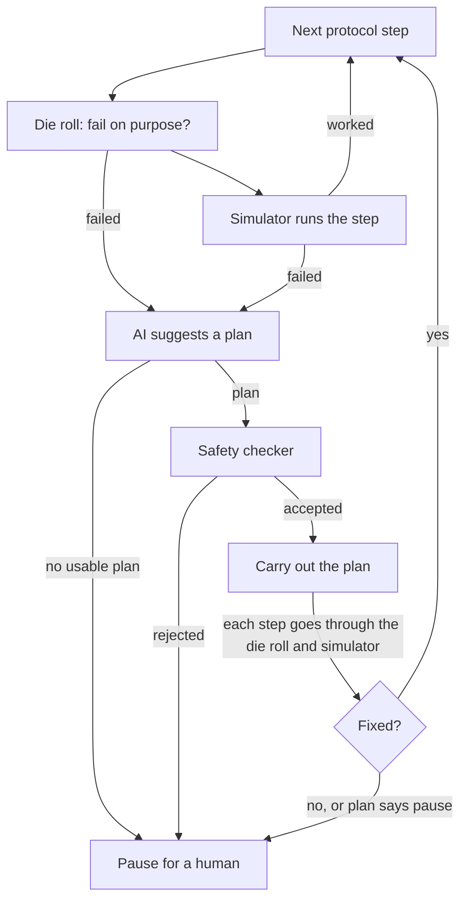

# Self-Healing Lab Cell

A simulated lab robot that tries to fix its own failures instead of only raising an alarm.

The robot moves liquid from one plate to another. Failures are caused on purpose. When one
happens, an AI suggests a fix, plain Python rules check it, and an approved fix goes back to
the robot. If the fix isn't allowed or doesn't work, the run pauses for a human.

There is no real hardware. [PyLabRobot](https://docs.pylabrobot.org) stands in for the robot.

## How it works



| Failure | Meaning |
|---|---|
| `tip_pickup_failed` | The tip didn't attach |
| `aspiration_failed` | Not enough liquid was drawn |
| `plate_missing` | The plate isn't on the deck |

The AI can only choose `retry_step`, `get_new_tip`, `reaspirate`, or `pause_and_alert`.
Its answer is never trusted on its own: the safety checker decides, without using AI.

## Set up

You need conda. From this folder:

```bash
conda env create -f environment.yml
conda activate self-healing-lab
```

## Run

**With the pretend AI** (no key or internet):

```bash
python -m self_healing_lab.main --fake-llm --seed 22 --fault-probability 0.3
```

**With Claude:** create an API key in the Claude Console, then enter it in your terminal. It
stays hidden as you paste. Each request costs a small amount.

```bash
read -rs ANTHROPIC_API_KEY && export ANTHROPIC_API_KEY
python -m self_healing_lab.main --seed 22 --fault-probability 0.3
```

A real run with Claude (Haiku 5.5):

```text
Using claude-haiku-5-5
Seed: 22, failure rate: 30%

Step 1: pick up a tip
Step 2: draw 100 µL from source A1
  FAILED: not enough liquid was drawn
  AI suggests: get_new_tip, then retry_step
  Safety check: accepted
  Fix worked, continuing
Step 3: release 100 µL into destination A1
Step 4: drop the tip

Result: completed
Steps run: 4 of 4
Failures: 1, fixed: 1
```

| Option | What it does |
|---|---|
| `--seed` | Repeats the same die rolls |
| `--fault-probability` | Chance that a step fails, from 0 to 1 |
| `--fake-llm` | Uses the pretend AI |

The pretend AI makes runs fully repeatable. Claude may choose a different plan each time.

## Test

```bash
pytest
```

The tests need no internet or key.

## Files

Everything is in `src/self_healing_lab/`:

| File | Job |
|---|---|
| `config.py` | All settings and limits |
| `models.py` | What steps, failures, and plans look like |
| `protocol.py` | Builds the list of steps |
| `simulator.py` | Pretends to be the robot; the only file that uses PyLabRobot |
| `faults.py` | Makes steps fail on purpose |
| `report.py` | Writes the failure report Claude reads |
| `agent.py` | Claude and the pretend AI |
| `validator.py` | The safety checker |
| `executor.py` | Carries out approved plans |
| `runner.py` | Runs the whole loop and returns a record of it |
| `printer.py` | Prints the log |
| `main.py` | The command you run |

## Limits

- The simulator tracks tips, liquid, and plates. It doesn't simulate physics.
- A failed draw moves no liquid, and changing the draw height doesn't change the odds.
- Each failure gets one plan. If it doesn't work, the run pauses.
- Claude has been tried once on each kind of failure. Measuring how often it succeeds comes later.
